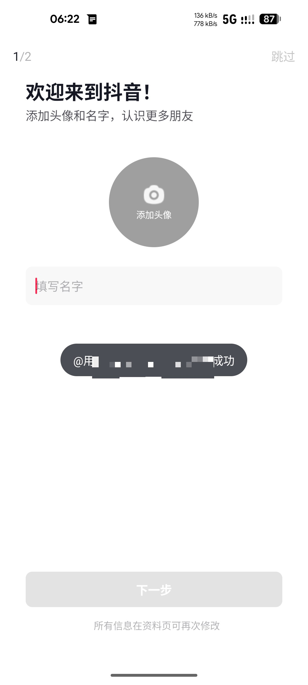
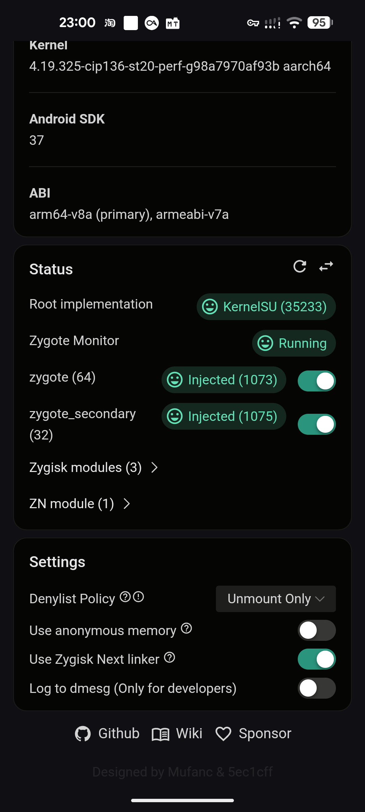

# Lineage Hide

Lineage Hide is a Zygisk module that removes LineageOS and other custom-ROM
fingerprints from applications.  Every third-party app is covered

## Compatibility

- Theoretically supports LineageOS 23.2 and newer;
- Tested on OnePlus 8T with LineageOS 24 (Android 17);
- If the `/system/bin/service` mount point is still exposed after installing
  the module, install the MetaModule:
  <https://kernelsu.org/guide/metamodule.html>;
- On OnePlus EU models, install the official App Market or some apps' feature
  checks will be triggered:
  <https://www.oppomobile.com/m/store.html>;
- **If some applications fail to open**, switch to this Zygisk Next build:
  <https://t.me/c/2022002916/124739> — the newer Zygisk injection
  implementation has a spin issue when injecting 360-hardened apps.

## Demo

Demo video of the hiding effect of this project: <https://b23.tv/437BHCi>

<p align="center">
  
  
</p>
<p align="center">
  
  
</p>

Douyin login succeeds on a OnePlus 8T:

<p align="center">
  
  
</p>

## Pairing with SUSFS (important)

The module only changes what a target *process* can observe.  What the kernel
reports — path visibility, already-open file descriptors, system properties —
is covered by SUSFS on a KernelSU kernel, and Lineage Hide ships the glue for
it:

- `service.sh` runs on every boot and uses the system-provided `ksu_susfs` command
  to enable `hide_sus_mnts_for_non_su_procs` and `enable_avc_log_spoofing`,
  register ROM-named files with `add_sus_path`, their mappings and idmaps with
  `add_sus_map`, and to delete or scrub lineage system properties with
  `resetprop`;
- it also hides the module's own `zygisk/arm64-v8a.so` and the Zygisk library
  from application `/proc/self/maps`;
- `/proc/<pid>/fd/*` readlink targets inherited from zygote need the kernel
  patch from `scripts/patch-kernel.sh`; SUSFS alone does not rewrite them.

Without SUSFS the module still hides the five in-process channels below, but
native file and property scanners can still fingerprint the ROM.

## Important Zygisk Next settings (otherwise some apps crash)

<p align="center">
  
</p>

Configure Zygisk Next as shown above, or some apps — 360-hardened apps in
particular — crash on launch:

- **Denylist Policy**: `Unmount Only`, not `Enforce DenyList`;
- **Use anonymous memory**: off;
- **Use Zygisk Next linker**: on.

The module requests `FORCE_DENYLIST_UNMOUNT` to unmount mount points inside app
processes, so these three settings need to stay consistent with it. See the
compatibility note above for the recommended Zygisk Next build.

## Hidden channels

| Channel | Mechanism |
| --- | --- |
| ServiceManager services | `BinderProxy.transactNative` JNI hook; enumeration and debug replies are filtered in the Parcel layer, direct app lookups are rewritten in a private request copy. Keywords: `lineage`, `crdroid`, `aospa`, `pixelexperience`, `omnirom`, `protonaosp`, plus the exact name `profile` |
| Resource package | AssetManager name/ID lookups treat `lineageos.platform` (resource package id `0x3f`) as absent |
| System features | `hasSystemFeature` requests are rewritten and the Parcel read path returns equal-length placeholders for the eight `org.lineageos.*` names |
| Protected broadcasts | the ten lineage protected actions are replaced in a private copy of outbound `IActivityManager` requests |
| Reflection constant | `AssetManager.LINEAGE_APK_PATH` is removed from `getDeclaredField`, `getField` and the `getDeclaredFields` family (AssetManager only) |

All in-process channels are always on, length-preserving, process-local and
never write into Binder reply buffers.

## Injection scope

There is no configuration.  The module injects a process when:

1. its uid is an application uid (`>= 10000`), and
2. its package is not a system package.

`service.sh` records the system packages at every boot
(`/data/adb/modules/lineage_hide/system_packages.txt`, generated from
`pm list packages -s`), so only third-party applications are touched.  In the
boot window before that list exists, a small hardcoded fallback protects
SystemUI, Settings, the permission controller, core providers, core services
and `org.lineageos.*` apps.  `FORCE_DENYLIST_UNMOUNT` is always requested.

To exclude an app, freeze it from the module by adding its package to
`system_packages.txt` (the file is regenerated on the next boot).

## Boot integration (`service.sh`)

After the boot animation starts, the module:

1. hides the `pm` command: `/system/bin/pm` is copied to `/data/system/pm_`,
   a wrapper is written to `/data/system/pm` and bind-mounted over
   `/system/bin/pm` in init's mount namespace with `nsenter -m -t 1`.  The
   wrapper forwards calls to `cmd package` and, for application processes
   (uid >= 10000), rewrites `lineage` → `lineagx` and `Lineage` → `Lineagx`
   in the output;
2. hides the service list.  On a OnePlus 8T (`ro.product.model=KB2000`) it
   remounts `/` read-write, backs up `/system/bin/service` as `service_` and
   writes a wrapper whose `service list` output is a fixed 392-entry list.  On
   every other device, or when the OnePlus path fails, it leaves the system
   partition untouched: the original is copied to `/data/system/service_`, the
   wrapper is written to `/data/system/service`, and the wrapper is
   bind-mounted over `/system/bin/service` in init's mount namespace with
   `nsenter -m -t 1`.  The OnePlus wrapper filters non-`list` output; the
   generic wrapper filters all output, both with the length-preserving
   `lineage` → `lineagx` rewrite;
3. rewrites `userdebug` to `user` in the `build.prop` files of `/system`,
   `/product/etc`, `/system_ext/etc` and `/system/system_dlkm/etc`, so the
   device no longer advertises debug build information;
4. spoofs bootloader and verified-boot properties: `ro.boot.flash.locked=1`,
   `ro.boot.verifiedbootstate=green`, `ro.boot.vbmeta.device_state=locked`,
   `ro.boot.vbmeta.avb_version`, `ro.boot.vbmeta.hash_alg`,
   `ro.boot.vbmeta.size`, plus `ro.debuggable=0`, `ro.force.debuggable=0`,
   `ro.secure=1`, `ro.adb.secure=1`, `ro.build.type=user`,
   `ro.build.tags=release-keys`, a recovery `ro.bootmode` and
   `init.svc.adb_root`, and sets `ro.config.ringtone` to `unknown`;
5. deletes system properties whose name contains `lineage` and rewrites values
   that contain `lineage`;
6. disables `org.lineageos.jelly` and records the system package list used by
   the injection scope above;
7. enables the SUSFS `hide_sus_mnts_for_non_su_procs` and
   `enable_avc_log_spoofing` switches, then walks `/data/resource-cache`,
   `/system`, `/vendor`, `/system_ext` and `/product` for `*lineage*` and
   `*gapps*` entries and registers them with `ksu_susfs add_sus_path`
   (`add_sus_map` for regular files);
8. registers additional paths and maps: `addon.d`, the LineageOS update
   directory, SELinux policy files, the platform resource RRO and its idmaps,
   the module's own native library and the Zygisk library.

`/system/lib64/libstagefright.so` is no longer registered with `sus_path` by
default, because hiding a core system library can have unknown side effects.
Uncomment line 511 of `service.sh` to hide it anyway.

The `pm` and service wrappers only rewrite output for application processes
(uid >= 10000); root/shell still sees the original output.  The service-list
step writes to the system partition only on OnePlus 8T; the generic bind-mount
path never touches it.  Step 3 remounts each affected filesystem read-write and
restores it read-only; where the filesystem cannot be remounted, the file edit
has no effect, but the property spoofing in step 4 still covers the runtime
values applications read.  Every step is idempotent and safe to repeat on the
next boot.  Unlike the in-process hooks, the property rewrites and SUSFS
registrations are global.

## Kernel-side path hiding

`scripts/patch-kernel.sh` applies the procfs complement to a kernel source
tree: for application UIDs (>= 10000) the path strings printed by
`/proc/<pid>/fd/*`, `/proc/<pid>/map_files/*`, `/proc/<pid>/maps`, `smaps` and
`numa_maps` are rewritten so they never contain the ROM keywords.  The patcher
is semantic (it locates functions, not line numbers) and idempotent, so trees
with vendor or SUSFS modifications work as well:

```bash
scripts/patch-kernel.sh /path/to/kernel          # apply
scripts/patch-kernel.sh --check /path/to/kernel  # status only
scripts/patch-kernel.sh --revert /path/to/kernel # remove
```

It writes `include/linux/lineage_hide.h`, edits `do_proc_readlink()` in
`fs/proc/base.c` and `seq_file_path()` in `fs/seq_file.c`, and backs up edited
files as `*.lineage_hide.bak`.  Rebuild and flash the kernel afterwards; only
the displayed string changes, file access and resource loading are untouched.

## KernelSU selinux_hide hardening

`scripts/selinux_hide_patch.sh` hardens KernelSU's `selinux_hide` feature, the
code that answers application selinuxfs queries from the policy copy captured
at boot instead of the running (KernelSU-modified) policy.  With the feature
enabled, the patcher adds three guards to `kernel/feature/selinux_hide.c` so
the fallbacks return `-EINVAL` for privileged contexts when the caller is an
application (uid >= 10000), instead of validating them:

- `my_write_context()` (`/sys/fs/selinux/context`) rejects `u:r:adbroot:s0`;
- `my_write_access()` (`/sys/fs/selinux/access`) rejects `u:r:shell:s0` +
  `u:r:su:s0`, `u:r:fsck_untrusted:s0` and `u:r:adbroot:s0`;
- `ksu_handle_selinux_setprocattr()` rejects `u:r:adbroot:s0`.

These probes are used by environment detectors to confirm privileged domains
(`su`, `adbroot`) behind the sanitized policy; refusing them keeps the answer
negative no matter which policy the kernel really runs.  Root and shell
processes are not affected.

Like `patch-kernel.sh` the patcher is semantic (function anchors, not line
numbers) and idempotent:

```bash
scripts/selinux_hide_patch.sh /path/to/kernel          # apply
scripts/selinux_hide_patch.sh --check /path/to/kernel  # status only
scripts/selinux_hide_patch.sh --revert /path/to/kernel # remove
```

`<tree>` is the kernel source root (KernelSU cloned at `KernelSU/` and
symlinked as `drivers/kernelsu`) or the KernelSU repo root itself.  The edited
`kernel/feature/selinux_hide.c` is backed up as `*.selinux_hide.bak`; rebuild
and flash the kernel afterwards.

## Build

Install Gradle 8.11.1, JDK 17 and the Android SDK/NDK.  The repository's
`gradlew` delegates to Gradle on `PATH`.

```bash
./gradlew :module:assembleRelease
bash scripts/package.sh
```

`v*` tags are built by GitHub Actions, which publishes `Lineage_Hide.zip` and
updates the root `update.json` on `main`, so Magisk/KernelSU managers offer
module updates from the repository's releases.

## Verification

Quick checks; the detailed checklist with commands is in
[README.zh-CN.md](README.zh-CN.md).

- In a third-party app: `getSystemAvailableFeatures()` shows no
  `org.lineageos.*` names, the `lineageos.platform` resource id `0x3f` is
  absent, and `AssetManager.class.getDeclaredField("LINEAGE_APK_PATH")` throws
  `NoSuchFieldException`.
- In a system app (Settings, SystemUI, `org.lineageos.*`) all of the above must
  still be visible, since those processes are never injected.
- `pm list packages` in a third-party app shows no `lineage` entries (they
  appear as `lineagx`), while root/shell still sees the original output;
- `service list` contains no ROM-named services (on KB2000 it returns the
  static 392-entry list), and root/shell still sees the original output.
  `getprop ro.boot.flash.locked` is `1`, `ro.boot.verifiedbootstate` is
  `green`, `ro.boot.vbmeta.device_state` is `locked`, `ro.build.type` is
  `user`, `ro.debuggable` is `0` and `ro.config.ringtone` is `unknown`.
- Douyin launches normally and passes its environment checks.
- `logcat -s LineageHide` shows the hook installation lines; `service.sh`
  output appears in the kernel/manager log.

## Boundaries

- Zygisk keeps the module `.so` mapped in zygote.  Updates require a reboot,
  and replacing the file under a live mapping can crash processes.
- `PendingIntent`-relayed broadcasts, native-only Binder lookups and native
  reflection are outside the current scope.
- The OnePlus 8T service list is a fixed snapshot; a ROM update that changes
  the service set can make it stale until the wrapper is regenerated.
- Hiding a core system library such as `/system/lib64/libstagefright.so` can
  have unknown side effects, so it is not registered by default; uncomment
  line 511 of `service.sh` to enable it.
- Without SUSFS and the kernel patch, native scanners can still observe ROM
  files, mappings and properties from application processes.
